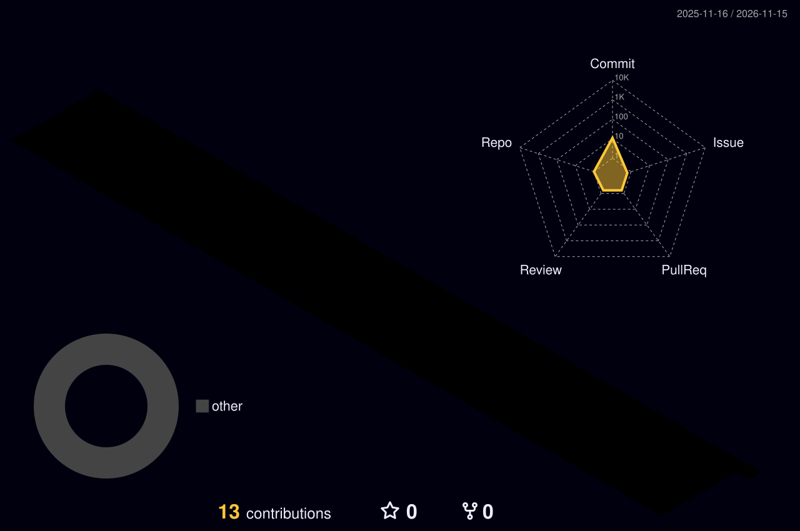

  <!-- Animated Gradient Header -->
  

  <!-- Animated Typing Introduction -->
  

   

  <!-- Technology Icons -->
  

    

  <!-- Social Badges -->
  
  
  

    

  

---

## 👨‍💻 About Me

I'm **Ratul Hasan Riad**, a Software Engineering student at **Daffodil International University (DIU)**, Bangladesh.

I'm interested in understanding how software works beneath the surface—from memory and algorithms to system design and software quality. I enjoy turning concepts into practical projects, improving my problem-solving skills, and learning how to build software that is efficient, reliable, and scalable.

- 🔭 **Currently working on:** C programming and a file-based Event Management System.
- 🌱 **Currently learning:** Data structures, memory management, software testing, and computer architecture.
- 🧠 **Interested in:** Systems programming, software architecture, algorithms, and AI/ML.
- 🤝 **Open to:** Learning opportunities, collaboration, and meaningful software projects.

---

## 🛠️ Tech Stack & Tools

  <h3>Languages</h3>
  

  <h3>Tools & Platforms</h3>
  

  

    
    
    
    
  

---

## 🚀 Featured Project

### 📅 C-Based Event Management System

A terminal-based event management application built in **C (C99)**. It uses file handling to store records persistently and is designed around practical event-management operations.

**Key features**
- Create, view, search, update, and delete event records.
- Store event details, including descriptions, venues, and date/time information.
- Organize the code into reusable modules.
- Validate user input and preserve data using file operations.

  

---

## 📊 GitHub Statistics

  
  

   

  

   

  

### 🧊 3D Contribution Calendar

  

---

## 🌐 Find Me Around the Web

  
  
  

    

  📍 Savar, Dhaka, Bangladesh

---

  <h2>✨ Thanks for Visiting!</h2>

  

   

  

    <i>The journey of learning never ends.</i>
  

   

  

    

  

  

